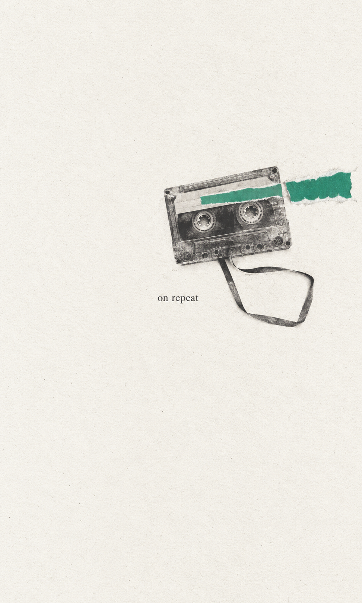

<!-- Visual direction and image prompt: assets/visual-direction.md -->

MAMBOJIANG &nbsp; / &nbsp; A PERSONAL INDEX

<h1>MamboJiang</h1>

<strong>Small games. Music tools. Web experiments.</strong>

Hi, I'm Mambo. I enjoy turning curious ideas into things you can play with, listen to, or explore.

  
  

TOOLS I REACH FOR

<picture><source media="(prefers-color-scheme: dark)" srcset="https://skillicons.dev/icons?i=swift%2Cgodot%2Cjava%2Cjs%2Cpython%2Cgit&amp;theme=dark&amp;perline=6"></picture>

 

## 01 / Selected work

**[VerseLoom](https://github.com/MamboJiang/VerseLoom)** &nbsp; MUSIC / SWIFTUI 
A native companion for music and bilingual lyrics.

**[LivelyKitchen](https://mambojiang.itch.io/livelykitchen)** &nbsp; GAMES / GODOT 
Two-player kitchen chaos, made for the 2025 CiGA GameJam. [Source](https://github.com/MamboJiang/LivelyKitchen)

## 02 / Activity

  <a href="https://github.com/MamboJiang?tab=repositories"><picture><source media="(prefers-color-scheme: dark)" srcset="https://github-stats-extended.vercel.app/api?username=MamboJiang&amp;hide=contribs%2Cissues&amp;hide_rank=true&amp;hide_title=true&amp;hide_border=true&amp;show_icons=false&amp;disable_animations=true&amp;card_width=420&amp;line_height=22&amp;border_radius=0&amp;bg_color=00000000&amp;text_color=C4CEC6&amp;title_color=A8C6B1&amp;icon_color=A8C6B1"></picture></a>
  <a href="https://github.com/MamboJiang?tab=repositories"><picture><source media="(prefers-color-scheme: dark)" srcset="https://github-stats-extended.vercel.app/api/top-langs/?username=MamboJiang&amp;layout=compact&amp;langs_count=4&amp;hide_title=true&amp;hide_border=true&amp;disable_animations=true&amp;card_width=420&amp;border_radius=0&amp;bg_color=00000000&amp;text_color=C4CEC6&amp;title_color=A8C6B1&amp;icon_color=A8C6B1"></picture></a>

<!-- A future blog section can be added here. -->

  Thanks for stopping by.  
  

